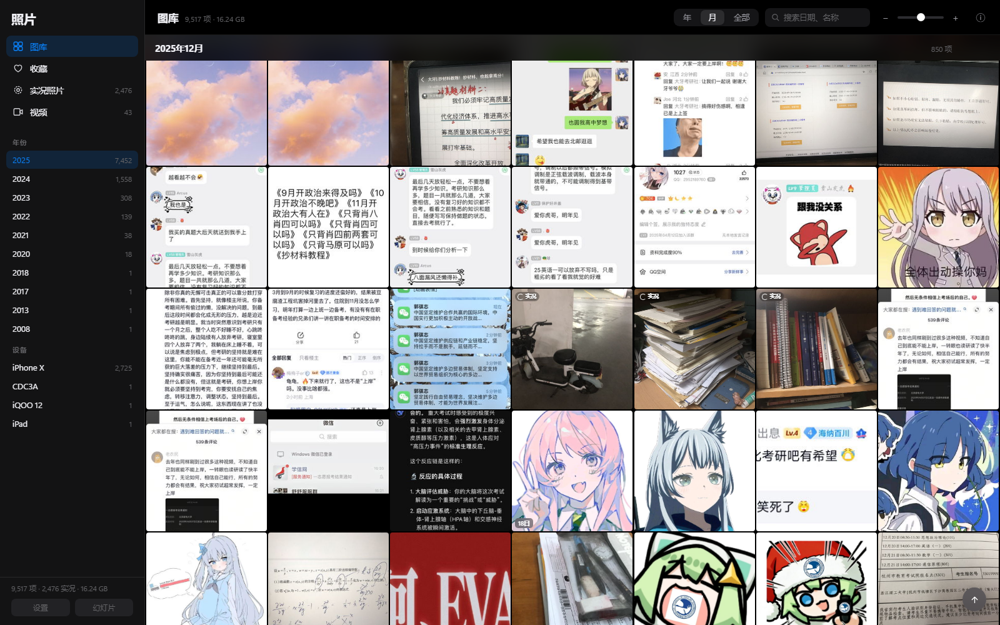
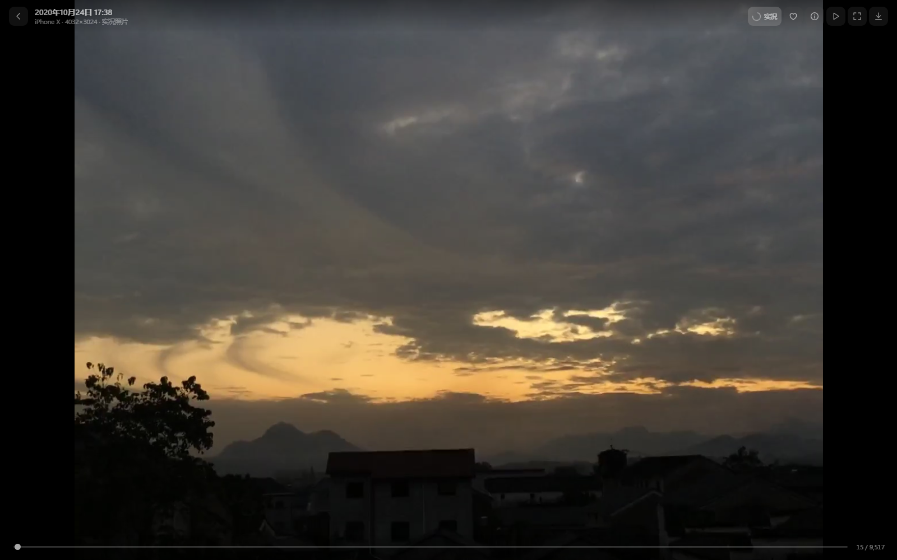
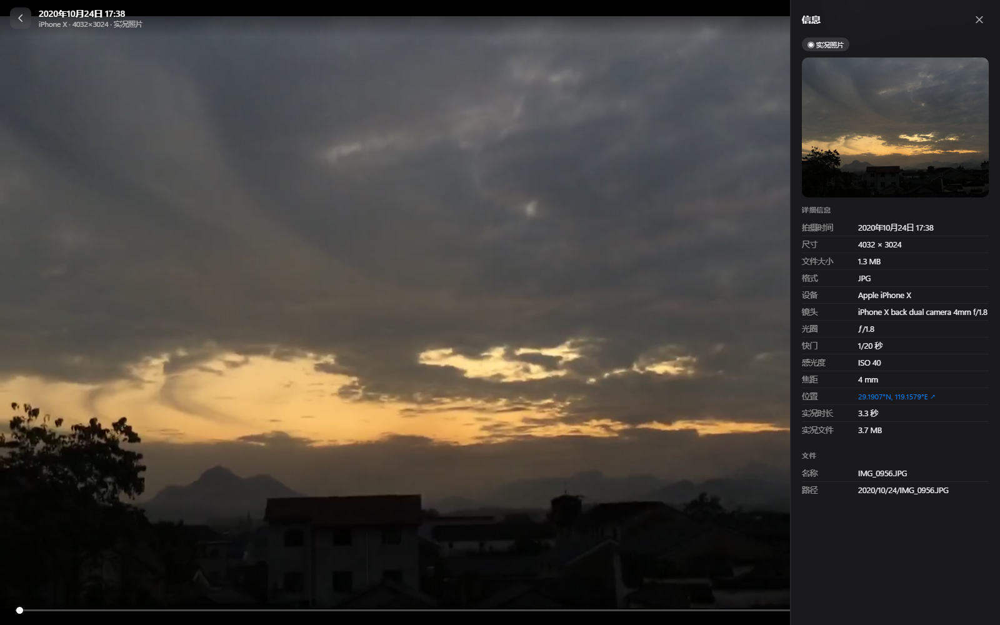
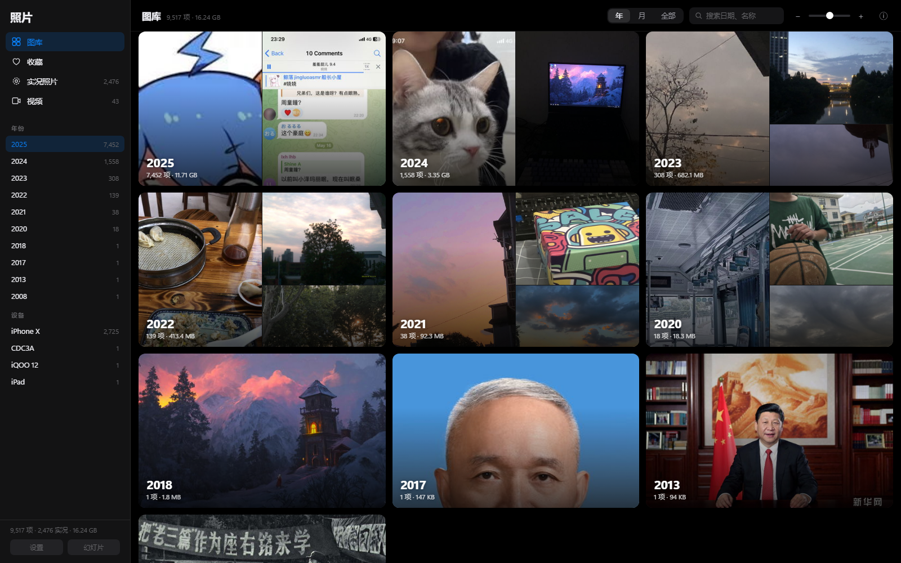

# 照片库 · iPhone 风格照片浏览器

把 iCloud 下载下来的 `photos/年/月/日` 目录变成一间自己的「iPhone 相册」：
按年 / 月 / 日浏览、点开大图、**实况照片（Live Photo）** 边看边动、视频直接播放、
查看 EXIF 信息、收藏喜欢的照片。

> **现在跑在 Linux 服务器上**：<http://100.114.x.x:7788>
> （Tailscale 内网，电脑和手机都能开，Windows 不用开机）
> 部署细节见下文「[部署在 Linux 服务器上](#部署在-linux-服务器上)」。

**当前库**：9,517 项媒体（9,474 张照片 + 43 个视频），其中 **2,476 张实况照片**，
覆盖 2008 – 2025 年，共 16.24 GB。

| 图库 | 实况照片 |
| --- | --- |
|  |  |

| 照片信息 | 年份总览 |
| --- | --- |
|  |  |

---

## 快速开始

> 想了解实现原理？看 **[技术文档.md](技术文档.md)** —— 技术选型、实况照片配对算法、
> 流式传输、性能实测数据，以及 11 个踩坑复盘。

| 场景 | 操作 |
| --- | --- |
| **平时看照片** | 打开 <http://100.114.x.x:7788>（Tailscale 内网） |
| **在 Windows 上单独跑一份** | 双击 `启动照片库.cmd`（默认 http://127.0.0.1:7788） |
| **照片有增删** | 双击 `重新构建索引.cmd`，再双击 `同步到Linux.cmd` |

首次从头构建约 50 分钟（扫描 30 秒 + 缩略图 12 分钟 + 视频转码 36 分钟），只做一次；
之后增量重建会自动跳过已有文件。

---

## 界面与操作

### 三种浏览密度（右上角「年 / 月 / 全部」）

- **年** —— 每年一张大卡片，九宫格封面，点进去到该年。
- **月** —— 按月分组的连续网格（默认），每天第一张左上角有小圆角日期标签。
- **全部** —— 按天分组，每天一个吸顶日期标题，最适合细看。

鼠标滚轮或键盘 `+` / `-` 可以随时缩放网格密度（相当于 iPhone 上双指捏合）。

### 查看器

| 操作 | 功能 |
| --- | --- |
| 单击缩略图 | 打开大图 |
| `←` `→` / 左右拖动 / 滚轮 | 上一张、下一张 |
| 双指捏合 / `Ctrl` + 滚轮 / 双击 | 缩放；放大后可拖动平移 |
| `空格` | 实况照片：带声音重播；视频：播放 / 暂停 |
| `F` | 收藏 / 取消收藏 |
| `I` | 打开右侧信息面板（相机、镜头、光圈、快门、ISO、GPS…） |
| `S` | 幻灯片自动播放 |
| `Esc` | 返回网格 |

**实况照片**：打开时自动无声播放一次（像 iPhone 一样），
点右上角「实况」按钮或按 `空格` 可以带声音重播；在网格里把鼠标悬停在缩略图上也会自动预览。

---

## 它做了什么

`photos/2023/09/15/IMG_0956.JPG` + `IMG_0956.MOV` 这种「静态图 + 同名视频」的组合，
会被合并成**一条**实况照片记录。程序会自动处理这几种命名：

- `IMG_1234.JPG` + `IMG_1234.MOV` （JPEG 静态图 + 实况视频）
- `IMG_1234.HEIC` + `IMG_1234_HEVC.MOV` （HEIC 静态图，苹果「高效」格式）
- `IMG_1234.HEIC` + `IMG_1234_livephoto_HEVC.MOV`
- `IMG_1234_HEVC(1).MOV` 这类重复下载的副本

浏览器普遍无法直接显示 HEIC、也不一定支持 HEVC 视频，所以构建时会生成一套「衍生文件」：

| 目录 | 内容 | 本库体积 |
| --- | --- | --- |
| `cache/thumbs/` | 512px 缩略图（网格用，约 27KB/张） | 0.24 GB / 9,474 个 |
| `cache/view/` | HEIC → JPEG 的浏览器可看版本 | 1.22 GB / 1,132 个 |
| `cache/live/` | 实况视频 / HEVC 视频 → H.264 MP4（可直接播放、可拖动） | 2.20 GB / 2,500 个 |
| `cache/poster/` | 独立视频的封面帧 | 43 个 |
| `cache/index.json` | 全部媒体的索引（日期、尺寸、EXIF、GPS、配对关系） | 2.4 MB |

原始照片**只读不改**，所有产物都在 `cache/` 里，删掉重跑即可。

---

## 目录结构

```
photoviewer/
├── 启动照片库.cmd          ← 双击启动
├── 重新构建索引.cmd        ← 双击重建
├── server.js               零依赖 Node 服务（静态页 + 媒体流 + 收藏持久化）
├── public/                 前端（原生 JS，无构建步骤）
│   ├── index.html
│   ├── styles.css
│   └── app.js
├── build/
│   ├── scan.py             扫描 + EXIF + 实况配对 → cache/index.json
│   ├── derive.py           缩略图 / HEIC 转 JPEG
│   └── transcode.py        实况视频与 HEVC 视频转 H.264 MP4、视频封面
├── tools/                  ffmpeg + 调试脚本（shot.js 截图、smoke.js 冒烟自检）
├── data/favorites.json     收藏（真正删除缓存也不会丢）
└── cache/                  所有衍生文件（可安全删除重建）
```

## 运行环境

- **Node.js** ≥ 18（启动服务；当前用 v24 验证）
- **Python** ≥ 3.9 + `Pillow` + `pillow-heif`（仅构建索引时需要，脚本会自动安装）
- **ffmpeg**（已随包放在 `tools/`，无需额外安装）

---

# 部署在 Linux 服务器上

照片库现在跑在 Tailscale 内的 Linux 服务器上，**Windows 可以完全关机**，
手机连上 Tailscale 也能直接看。

| 项目 | 值 |
| --- | --- |
| 访问地址 | **http://100.114.x.x:7788** |
| 主机 | `minecraft-server`（Ubuntu，8 核 / 7.3 GB 内存） |
| 部署目录 | `/home/mc/photoviewer` |
| 服务 | systemd 用户服务 `photoviewer.service`（开机自启，已开 linger） |
| Node 运行时 | `/home/mc/.local/node/bin/node`（v22.23.3，装在用户目录，不动系统） |
| 监听 | `100.114.x.x:7788` —— 只绑 Tailscale 网卡，局域网/公网访问不到 |

目录结构（Linux 侧）：

```
/home/mc/photoviewer/
├── server.js  public/  build/  data/
├── photos/         原图 22 GB（11,993 个文件，从 Windows 搬过来的）
└── cache/          缩略图 / HEIC 预览 / 实况 MP4，共 3.8 GB
```

### 常用命令

```bash
systemctl --user status photoviewer      # 看状态
systemctl --user restart photoviewer     # 重启
systemctl --user stop photoviewer        # 停止
journalctl --user -u photoviewer -f      # 实时日志
```

### 换 Tailscale IP 怎么办

Tailscale 分配的 IP 一般不变。若变了，改服务里的 `--host`：

```bash
systemctl --user edit photoviewer        # 修改 ExecStart 里的 --host
systemctl --user daemon-reload && systemctl --user restart photoviewer
```

### Windows 上新增照片后怎么同步

1. Windows 上双击 **`重新构建索引.cmd`**（生成新缩略图 / 实况转码）
2. 双击 **`同步到Linux.cmd`** —— 自动把有变化的年/月、全部缓存、索引传过去，
   并重启远端服务。只重传变化的部分，通常几十秒到几分钟。

手写命令也行：

```powershell
powershell -File tools\transfer-photos.ps1                       # 原图
tar -cf - -C cache thumbs view live poster index.json jobs.json |
  ssh mc "tar -xf - -C /home/mc/photoviewer/cache"               # 缓存
ssh mc "systemctl --user restart photoviewer"                    # 重启
```

> 注意：`tools/transfer-photos.ps1` 必须保存为 **UTF-8 with BOM**，否则 Windows
> PowerShell 5.1 会把里面的中文路径按 GBK 读错，导致所有分块被跳过。

---

## 常见问题

**端口被占用？** 服务会自动改用 7789、7790…，以窗口里打印的地址为准。

**照片有增删？** 重新双击「重新构建索引.cmd」，已生成的缩略图会自动跳过，只处理新增部分。

**想换照片目录？** 设置环境变量 `PHOTOS_DIR` 指向新路径后再启动，例如：

```bat
set PHOTOS_DIR=E:\我的照片
node server.js --open
```

**收藏存哪？** `data/favorites.json`，纯文本，可以直接备份。
